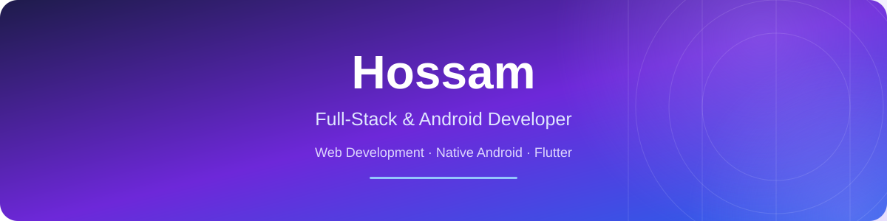

 

  

   

  

   

  

---

## 👋 About Me

I'm **Hossam**, a Full-Stack Developer working across web and mobile development, including Native Android and Flutter applications.

I enjoy turning ideas into practical software products, building responsive user interfaces, developing backend services, and integrating databases and application workflows.

- 🚀 Building real-world products that solve practical problems.
- 🌐 Developing modern web applications and backend services.
- 📱 Building Native Android applications with Kotlin and Java.
- 💙 Developing cross-platform mobile applications with Flutter.
- 🧩 Focused on clean code, maintainability, and modern UI/UX.
- 🤝 Open to freelance projects, professional opportunities, and collaboration.

## 🛠️ Tech Stack

  <h4>Frontend Development</h4>

  

  <h4>Backend & Database</h4>

  

  <h4>Native Android Development</h4>

  

  <h4>Cross-Platform Mobile Development</h4>

  

  <h4>Tools & Workflow</h4>

  

## 🚀 Featured Projects

### 01. LearnHubz

**An Online Learning Platform**

LearnHubz is an educational platform project designed to connect students and teachers through online lessons.

- 👨‍🏫 Dedicated experiences for teachers and students.
- 📚 Lesson discovery and booking workflows.
- 💳 Payment integration and transaction workflows.
- 📊 Role-based dashboards and lesson management.

**Focus:** Full-stack development, educational technology, and application workflows.

### 02. Orbit Dash

**A Mobile Arcade Game**

Orbit Dash is a Flutter-based mobile arcade game project focused on interactive gameplay and player feedback.

- 🎮 Mobile game development with Flutter.
- ✨ Interactive feedback and visual effects.
- 🧩 Gameplay implementation and iterative improvements.

**Focus:** Flutter, mobile development, and user experience.

## 📊 GitHub Statistics

  

  

   

  

## 🤝 Let's Connect

I'm interested in connecting with developers, founders, and teams building useful products.

  

   

  *Building real products. Learning every day. Improving with every commit.*

  

